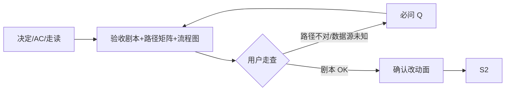

# 生命周期（sop-v2）

## 阶段与出口

```
S0 项目手册（持续维护）
   │
S1 需求与设计 ──确认剧本+改动面──▶ S2 实现与交付 ──交付物──▶ 编译 / 部署 / 执行验证清单
                                 ▲                                │
                                 └─ S3 验证与修复 ◀─ 结果 ─┘（循环至全过）→ 合并 → 发布线 → 上线 → R 复盘 → 回填 S0
```



出口须可判定。S1/S2/S3 判定前先自我纠错。**S1**：必问已关；用户确认**验收剧本/路径矩阵**；再确认改动面。S2：precheck PASS、可编译则过、已 commit、交付齐、门禁如实（不需用户评审）。S3：最新清单全过。R：回填记录有本需求一行。

## 自我纠错

出口前对照证据**改产物再复查**（只列疑点不算；非门禁）。证据：S1=原文/代码/回复；S2=改动面/AC/决定/剧本/diff/参照/precheck·编译；S3=结果原文/AC/被改代码/参照/precheck·编译。无新 `文件:行` 或编号问题则停。

| 风险 | 规则 |
|------|------|
| 死循环 | 同处最多两轮；仍不对→待定/无法证明。无新外部结果不得再改 |
| 同源偏差 | 只读上列证据。审查交新上下文（验收/决定/设计/走读/diff）。不得同推理宣布审查或门禁过 |
| 幻觉放大 | 只改到与证据一致或删无出处；没有→待定。**数据从哪来/用什么键查/查不到算什么**未关闭前，禁止写识别链或「借另一业务域查询来拦截」。技术照参照。推测不当事实 |

## 门禁与证据

三态：**通过 / 失败 / 无法证明**。「无法证明」≠通过，写入交付说明与手册「风险」。

| 门禁 | 证明 | 「无法证明」何时 |
|------|------|------------------|
| 编译 | 能构建 | 离线编译仍不通→交构建环境，r1 补 |
| 单测 | 纯逻辑 | 跳过测试 / 无依赖 / 运行数=0 |
| precheck | 静态错 | 不证明行为 |
| 审查 | 每条 AC 有位置；阻塞类清零 | 未做独立审查 |
| 交付可用性 | 按「你要做的」能否独立做完 | 未找茬或任一条否 |
| 验证清单 | 行为符合 AC | 未执行 |
| 用户回复 | 业务口径 | 必问未回复 |

自造桩=自测，不算证据，输出不进 `S2/`。

## 问题分类

| 类别 | 判断 | 处理 |
|------|------|------|
| 需求不符 | 需求/决定/AC/剧本未做到；管控形同虚设 | 阻塞，本轮修；改不了→必问 |
| 交付与部署 | 照手册做不成或做完不能用 | 阻塞，本轮修 |
| 安全 | 需求未写的防攻击 | 「后续优化」，不阻塞 |
| 实现质量 | 不改行为的问题 | 同上 |

口诀：需求写了的管控没做到=需求不符；需求没写的防护=安全。

## 指标

只记：首次编译 B 类、验证轮次、S2 审查需求不符、S3 C 类本该审查发现、C 类归因为设计错。

## 按需求类型裁剪

S1 判类型写入 `00-当前位置`。拿不准按上一档。

| 类型 | S1 | S2 | S3 | R |
|------|----|----|----|---|
| 新功能/跨服务 | 全部（含验收剧本/路径矩阵/流程图） | 全部 | r1 冒烟→r2 全量+回归 | 做 |
| 小改动 | `S1-07`（含短剧本）+Q+交付选项 | 全部 | 一轮 | 有新事实才做 |
| 线上缺陷 | `S1-07`：现象/复现/根因/修法/短剧本；AC=不再复现 | `hotfix/{编号}` | 复现+回归 | 只回填根因 |
| 纯配置/数据 | `S1-07`：改什么/影响/短剧本 | 只出 sql/config/手册/清单 | 一轮 | 不做 |

### 交付选项

与待定一次发出；**须用户回复**。

| 选项 | 规则 |
|------|------|
| 环境形态 | 每需求必选 |
| 交付范围 | 两端都碰时必问；只改一端按本端可验拆 AC |
| 仅前端/仅后端 | 见既有：接口须读到实现；仅后端默认文档+冒烟 |
| 交互流程 | 跨服务/回调/多步令牌，或**多数据源/多模式/有本期预留**→建议产出 `S1-06`（含路径图） |

## 需求变更

新 `D-xx`，旧条「被 D-yy 替代」；受影响 AC/剧本标变更并改设计；已交付轮不改。SOP 更新后补齐至终包 PASS 再出下一轮。

## 环境形态

用户 S1 选；S2 Step 0 实测，不符则改选。

| 编译部署 | 编译 | 交付 | 验证 |
|----------|------|------|------|
| 可编译可部署 | 本机 | 分支/PR | 自跑 |
| 可编译不可部署 | 本机 | 分支/PR+清单 | 部署人带回 |
| 不可编译 | 构建环境 | 改动包+`S2/` | 构建+执行带回 |
| CI | CI | 分支/PR | CI+测试环境 |

| 代码 | 基线 | 交付 |
|------|------|------|
| 在线仓 | 开发分支 HEAD | 推分支、PR |
| 离线快照 | 导入提交 | 每子目录 patch；真实仓 apply |
| 无 git | 先 `git init` | 同离线 |

离线 **不能 rebase**；apply 败→快照刷新（环境准备）。

## 验证循环

一轮=交付+结果。r1：编译单测→SQL/配置→部署→verify→冒烟(≤8)；r2 全量+回归；其后失败项+受影响。SQL/配置可重入。

| 类 | S3 |
|----|-----|
| A 基线 | 在线 rebase；离线软回退全量；禁远距增量 |
| B 编译/单测 | 修码；能静态查→precheck |
| C 行为 | 先问题分类。**漏拦/文案错**：先核识别链是否有已关闭 D；没有→设计错/必问，**禁止补守卫当实现修复**。实现错修码；设计错先改设计 |
| D 环境事实 | 回写 S2；影响口径→待定 |

## 交付可用性

出包前必做。找茬否→修完重做（同处≤两轮）：①按「你要做的」能独立做完（细节靠引用）②选表仅合法三行③最终态 sql/config/登记/仅重启已入步骤④三处同文+短用途⑤三态各一行⑥基线自证；apply 败软回退⑦白名单与内容预算⑧**「你要做的」无待定 Q、无「逐条回」**（必问未关停在必问态，不出执行清单）⑨**增量与全量命令分属独立复制块**（产出模板）。**A**「交付可用性|通过|找茬1–9无否」；**B** `S3-02` 可用性复核。未过 A=未交付。

## 合并与发包

`feature/{需求}` 合发布线走 PR。共享依赖合入后由构建发，**禁功能分支 SNAPSHOT**。

## 当前位置

`00-当前位置.md` 每项**一行短句**。「你要做的」=对话末条。「最近结果」禁贴整份 README。

| 停在 | 你要做的 | 只看 |
|------|----------|------|
| S1 必问未关 | 逐条确认逐条回；其余可「全按建议」 | `S1-05` / `S1-07` |
| S1 待走查 | 按剧本走查：回「剧本确认」或指出哪条路径不对 | 设计「验收剧本/路径矩阵/流程图」 |
| S1 待评审 | 回「确认改动面」或指出增删 | 设计「改动面」 |
| S2 有一个问题 | 只答那一问 | `S2-01` |
| S3 待执行 | 短清单（见下） | 终包 README；`S2-07` 本轮行 |
| 待合并 / 已上线 / R 有后续优化 | 同前 | 同前 |

**S3 短清单**（H6；骨架见产出模板）：≤35 行；前置≤2、本轮≤6；每步≤120 字；禁嵌套/上轮报错/待定 Q；编译重启在选表单元格。增量仅相邻；发用户前见「交付可用性」。

## 决策

拍板只在 `S1-05`（精简版 `S1-07`）。S1 一次问齐；S3 新发现攒批。

| 级别 | 范围 | 关闭 | 未关 |
|------|------|------|------|
| 必问 | 业务口径、**数据来源与查询键**、权限身份、金额时效、状态与数据处置、文案、共享边界、原文矛盾 | 用户明确回复；逐条确认不接受「全按建议」 | 相关代码不交付；S1 不出口 |
| 照先例 | 有参照的技术细节 | 按参照定并列出供推翻 | 不阻塞 |

- **逐条确认**：与原文相反/删减、放宽管控、金额时效、多实现选址、**数据从哪来/查什么键/查不到算什么**、本期不做时如何表现（藏入口/明确文案且**不查下游**）。
- `本期不做` 只允许藏入口或明确文案拦截；**禁止**为拦截去调另一业务域查询（除非该链已有关闭的 D）。
- 先例有缺陷：标出并按问题分类，不照抄。拿不准按必问。

## 单一真相源

| 东西 | 唯一存放 | 别处 |
|------|----------|------|
| 业务口径 | `S1-01` `D-xx` | 引编号 |
| 需求/验收 | `S1-02` | 引编号 |
| 验收剧本/路径矩阵 | 设计说明（或 `S1-07`） | 走查确认后约束 S2；S3 引用 |
| 待定 | `S1-05` `Q-xx` | 引编号 |
| 改动面 | 设计「改动面」 | 确认后进 S2 |
| 审查 | `S2-08` | 交付说明、R |
| SQL/配置/手册/清单/verify | `artifacts/.../S2/` | 与终包并列 |
| 项目事实 | `S0-01` | 引章节 |

## 共享边界

要改共享仓：设计「共享边界触碰」→必问·逐条确认→同意后只改同意范围。

## 不做的事

不做常驻全量基线；不拆 STORY/TASK；不做执行记录/时间盒；不用「本地核对」代替证据。交付可用性≠验证清单通过。
